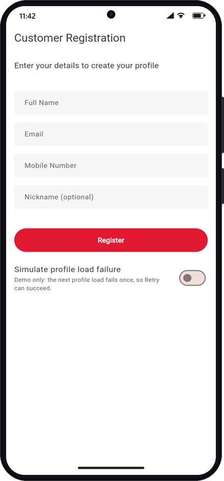
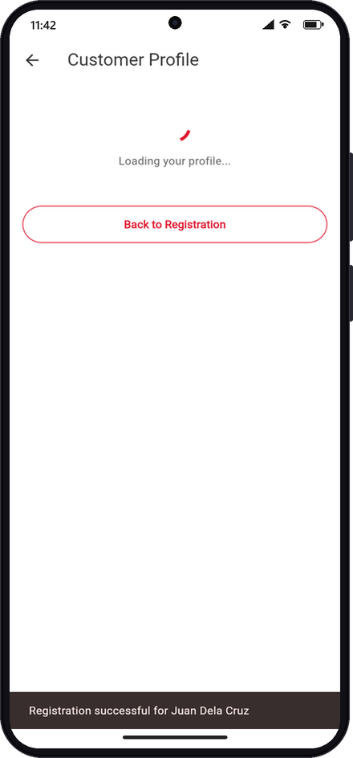
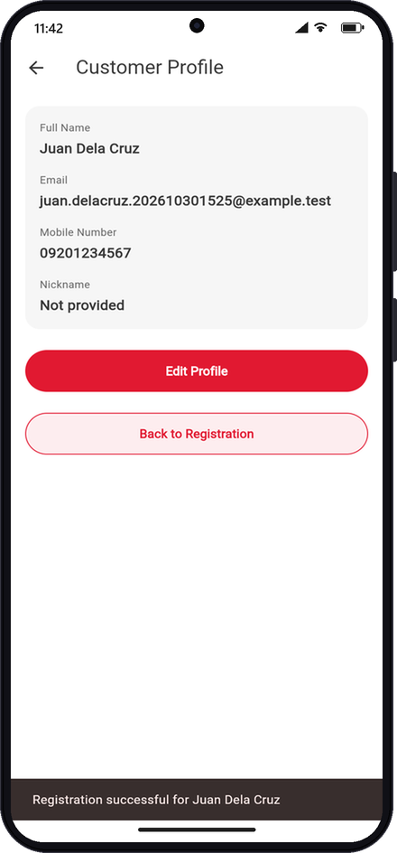
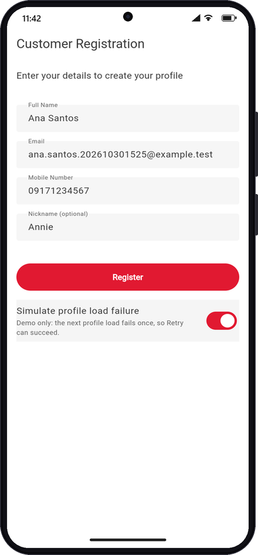
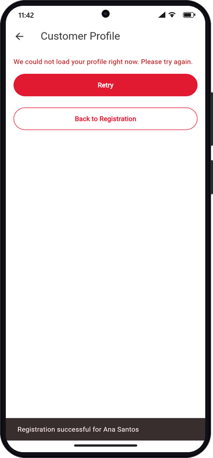
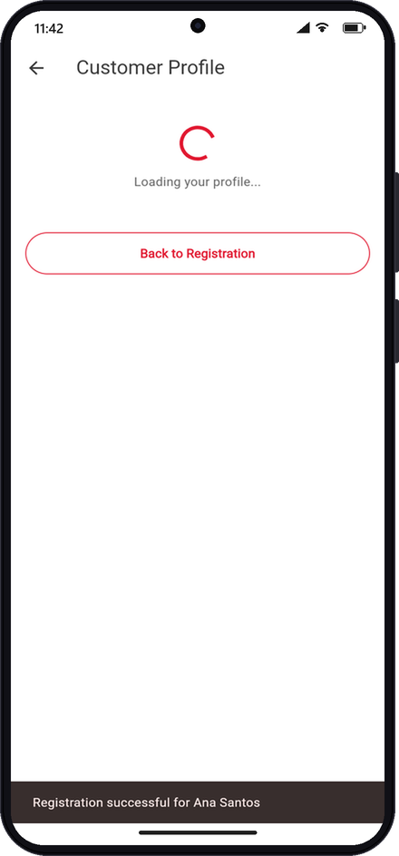
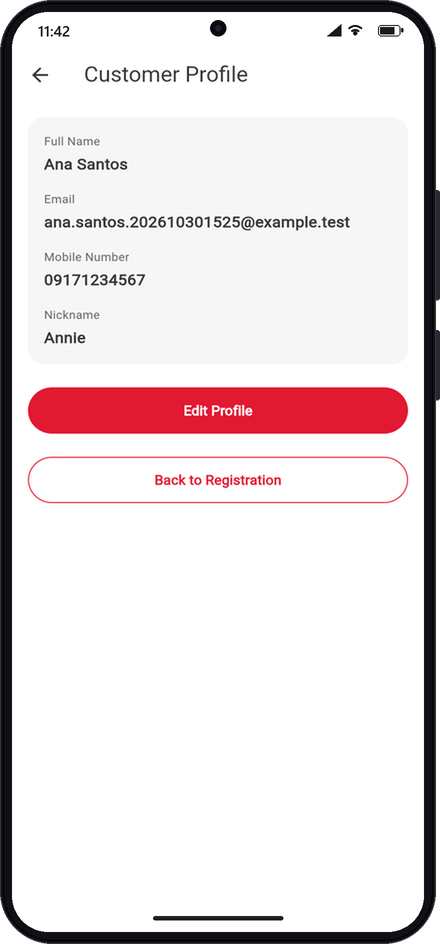

# Week 3 exercise results — screenshots and scenarios

Every screenshot below was captured on **2026-10-30** against the **live**
local stack — Flutter web UI `http://127.0.0.1:5100` (branch
`feature/week-3-async-profile-loading`, debug build), Spring Boot
`http://localhost:8080`, PostgreSQL `localhost:5432` — by a scripted browser
at a Pixel-class viewport (412×892 CSS px, 2×) and composed into an Android
frame. Registration is real (`POST /api/customers` → `201`); the profile is
loaded by the default `FakeCustomerProfileService` (2 s delay). Test data uses
the stamp `202610301525`.

Story guides: [US-05 — Load customer profile](week-3/load-customer-profile.md)
· [US-06 — Handle profile loading errors](week-3/handle-profile-loading-errors.md).
Full automated matrix: [Test evidence and scenarios](testing.md).

## Scenario summary

| # | Story | Scenario | Result |
|---|---|---|---|
| 1 | US-06 | Registration shows the debug-only **Simulate profile load failure** switch (off) | Pass |
| 2 | US-05 | After Register, Profile shows **Loading your profile...** while the `Future` is pending | Pass — `POST` 201, `id=21` |
| 3 | US-05 | After ~2 s the customer appears | Pass — matches DB row `id=21` |
| 4 | US-06 | Switch turned **on** before registering the next customer | Pass |
| 5 | US-06 | Load fails → user-friendly error + **Retry**, no crash | Pass — `POST` 201, `id=22` |
| 6 | US-06 | **Retry** → loading again | Pass |
| 7 | US-06 | Retry succeeds → customer shown, loading reset | Pass — matches DB row `id=22` |

## 1. Registration with the demo switch (US-06 setup)

The switch is bound to `FakeCustomerProfileService.failNextLoad` and only
exists in debug builds. Off means the next profile load succeeds.



## 2. Loading state while the Future is pending (US-05)

Registered `Juan Dela Cruz` / `juan.delacruz.202610301525@example.test` /
`09201234567`. Registration navigated with the id only; the Profile started
`loadProfile(21)` from `initState` and rendered the loading view
immediately. The SnackBar and Back button stay responsive — the UI isn't
blocked.



## 3. Customer appears after completion (US-05)

When the `Future<Customer>` completed, `setState` replaced the loading view
with the customer card (nickname null → `Not provided`).



## 4. Turn on the simulated failure (US-06)

Back on Registration, entered `Ana Santos` /
`ana.santos.202610301525@example.test` / `09171234567` / `Annie` and turned
the switch on.



## 5. Error message and Retry (US-06)

Registration itself succeeded (`201`, `id=22`); the **profile load** then
threw `CustomerServiceException`. The app didn't crash: the loading state
was cleared in `finally` and the message and **Retry** were shown. Edit
Profile is hidden because there is no customer to edit.



## 6. Retry starts a new load (US-06)



## 7. Retry succeeds (US-06)

The flag fails exactly one load, so the retry returned the customer.



## Backend confirmation

```text
 id |   full_name    |                  email                  | mobile_number | nickname
----+----------------+-----------------------------------------+---------------+----------
 21 | Juan Dela Cruz | juan.delacruz.202610301525@example.test | 09201234567   |
 22 | Ana Santos     | ana.santos.202610301525@example.test    | 09171234567   | Annie
```

Browser network log for the run: `POST /api/customers → 201` (twice). No
`GET` was issued because the fake profile service is the default; build with
`--dart-define=USE_BACKEND_PROFILE=true` to load through
`GET /api/customers/{id}` instead.

Synthetic customers from this and earlier capture attempts (`id=19..22`,
stamps `20261030*`) remain in the local development database.
