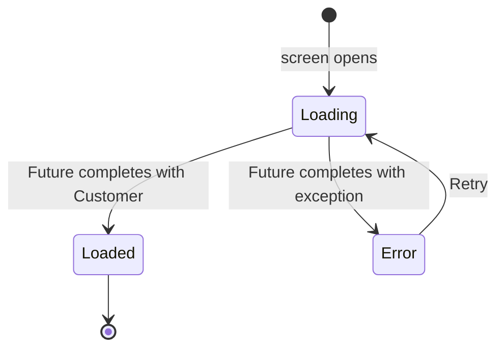

# Handle profile loading errors (US-06)

> **Business story:** As a customer, I want to see a useful message when my
> profile cannot be loaded so that I know what happened and can try again.

## What was built

| Layer | Change |
|---|---|
| Fake service | `FakeCustomerProfileService.failNextLoad` (`ValueNotifier<bool>`). When set, the next load waits the usual delay and then **throws** `CustomerServiceException('We could not load your profile right now. Please try again.')`, then resets itself — so Retry succeeds. |
| Demo control | Debug builds show a **Simulate profile load failure** switch on Registration (`AppSwitchTile` bound to `failNextLoad`). Hidden in release builds and when the real backend profile is used. |
| Profile | `_loadProfile` wraps the `await` in `try` / `on CustomerServiceException catch` / `catch` / `finally`. Failures set `_errorMessage`; `finally` always clears `_isLoading`. |
| Error UI | `AppErrorView` — the message (live region, error color) and a **Retry** `AppPrimaryButton`. Retry resets to loading and runs the same load again. |

## Acceptance criteria → evidence

| Acceptance criterion | Where it is satisfied | Proof |
|---|---|---|
| An exception does not crash the application | Every exception from the `await` is caught; unexpected types get a generic message | Widget tests *a failed load shows the error and Retry, not a crash* and *an unexpected exception becomes a generic retryable error* (`tester.takeException()` is `null`) |
| An error is visible to the user | `AppErrorView` with the service's message | Screenshot 05 |
| Retry attempts the load again | `_retry()` → `_isLoading = true` → `_loadProfile()` | Widget test *Retry loads again and shows the customer on success* (service called twice); screenshots 06–07 |
| Loading is reset after success or failure | `finally { setState(() => _isLoading = false) }` | Assertions `loading findsNothing` after both outcomes |
| Explain `try`/`catch`/`finally` | See below | — |
| Explain normal results vs exceptions | See below | — |

## The flow



```dart
Future<void> _loadProfile() async {
  try {
    final customer = await widget.profileService.loadProfile(widget.customerId);
    setState(() => _customer = customer);            // normal result
  } on CustomerServiceException catch (exception) {
    setState(() => _errorMessage = exception.message); // expected failure
  } catch (_) {
    setState(() => _errorMessage = _unexpectedErrorMessage); // anything else
  } finally {
    setState(() => _isLoading = false);              // always
  }
}
```

(The real code also checks `mounted` and a load generation before each
`setState`, so a load that finishes after the screen closed — or after a newer
load started — is ignored.)

## Concepts

### `try` / `catch` / `finally`

* **`try`** — the code that might fail; with `await` inside, an error the
  `Future` completes with is rethrown at the `await` line.
* **`on CustomerServiceException catch (e)`** — the *expected* failures the
  service already translated into user-friendly text (timeout, network,
  404, simulated failure). Their message is safe to show.
* **`catch (_)`** — a safety net for *unexpected* errors (bugs, bad data).
  The raw error is never shown; the user gets a generic, retryable message.
* **`finally`** — runs after the `try` *and* after any `catch`, even after a
  `return`. Resetting `_isLoading` here is what guarantees the spinner can
  never get stuck, whichever path ran.

### Normal results vs exceptions

A **normal result** is the value the operation exists to produce — the
`Customer`. An **exception** signals that the operation could *not* produce
its result (no connection, not found, server error). Exceptions skip the rest
of the `try` and jump to the matching `catch`, so the success code never runs
with missing data. In async code an unhandled exception is not lost — it
completes the `Future` with an error, which `await` rethrows; without the
`catch` it would surface as an uncaught error instead of a message.

### Why Retry works

Retry doesn't need a special path: it resets the state to loading and calls
the same `_loadProfile()`. The fake's `failNextLoad` flag fails exactly once,
which models a transient failure (e.g. a dropped connection) that succeeds
on the next attempt.

## Edge cases tested

* Retry fails again → the new error is shown and Retry is still available.
* Unexpected exception type (`StateError`) → generic message, internal text
  (`boom`) never shown.
* End to end through `MyApp`: switch on → register → error → Retry → customer.

## Related

* [Load customer profile (US-05)](./load-customer-profile.md)
* [Week 3 exercise results](../week-3-exercise-results.md)

# Citations

[1][Profile screen](../../lib/screens/profile_screen.dart)
[2][Fake customer profile service](../../lib/services/fake_customer_profile_service.dart)
[3][Error view widget](../../lib/widgets/app_error_view.dart)
[4][Profile loading widget tests](../../test/profile_loading_test.dart)
