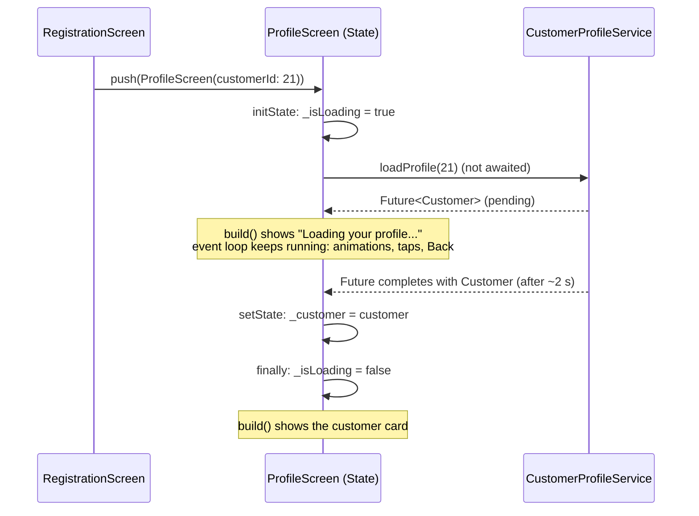

# Load customer profile (US-05)

> **Business story:** As a customer, I want my profile to be loaded
> asynchronously so that the application can retrieve information from a
> backend service.

## What was built

| Layer | Change |
|---|---|
| Abstraction | `CustomerProfileService` (`lib/services/customer_profile_service.dart`) — one method, `Future<Customer> loadProfile(int customerId)`. The Profile screen depends on this interface, not on HTTP. |
| Fake service | `FakeCustomerProfileService` — in-memory records, **2 s simulated delay** (`Future.delayed`), then returns the customer. It learns about customers from `CustomerService.savedCustomers`, a broadcast `Stream` of every customer the backend confirms on register/update, so the fake always returns what was really saved. |
| Real service | `CustomerService` also implements the interface with `GET /api/customers/{id}` (200 → `Customer`, 404 → "no longer exists"). Opt in with `--dart-define=USE_BACKEND_PROFILE=true`. |
| Composition | `MyApp` is now a `StatefulWidget` that creates `CustomerService` and the profile service once and passes them down (constructor injection; tests inject their own). |
| Navigation | Registration pushes `ProfileScreen(customerId: …)` — only the **id**. The Profile loads the customer itself. |
| Profile | Starts in the loading state, calls `loadProfile` from `initState` (not awaited), shows `AppLoadingView` (spinner + "Loading your profile...") while waiting, then the customer card. |
| Shared UI | `AppLoadingView` (spinner + message, live region). |

## Acceptance criteria → evidence

| Acceptance criterion | Where it is satisfied | Proof |
|---|---|---|
| Customer retrieval is asynchronous | `loadProfile` returns a `Future`; the fake `await`s `Future.delayed(2 s)` before completing | Unit test *loadProfile_completes only after the simulated delay* |
| `Future<Customer>` is used | `CustomerProfileService.loadProfile` signature; both implementations | Code; `customer_service_test.dart` *loadProfile_gets the customer by id* |
| Loading is visible while waiting | `_isLoading` starts `true`; `AppLoadingView` is rendered until the Future settles | Widget test *shows loading while waiting, then the customer*; screenshot 02 |
| Customer information appears after completion | `setState(() => _customer = customer)` after `await` | Same widget test; screenshot 03 |
| UI is not blocked | Back works while the Future is still pending | Widget test *UI stays interactive while the profile is loading* |
| Explain async/await | See below | — |
| Explain why `Future<Customer>` is not a `Customer` | See below | — |

## How the code flows



## Concepts

### `Future<Customer>` vs `Customer`

A `Future<Customer>` is a *promise* that a `Customer` will be available
later (or that an error will be). At the moment `loadProfile` returns, the
customer does not exist yet on our side — the "network" hasn't answered — so
Dart's type system will not let you read `fullName` from it:

```dart
final future = service.loadProfile(21);   // Future<Customer>
future.fullName;                          // compile error
final customer = await future;            // Customer — only after completion
customer.fullName;                        // OK
```

Treating it as a `Customer` immediately would mean reading data that hasn't
arrived; the type difference forces you to wait (`await`/`then`) or handle
the pending state explicitly.

### `async` / `await`

* `async` marks a function that returns a `Future` and may pause.
* `await` pauses **that function only** until the `Future` completes, then
  unwraps its value (or rethrows its error so `try`/`catch` can handle it).
* While paused, Dart's single-threaded **event loop** keeps running: frames
  render, the spinner animates, and taps (Back) are handled. That is why the
  UI never freezes — nothing blocks the thread; the function is resumed when
  the result arrives.

### Why the load starts in `initState` without `await`

`initState` must return synchronously, and the first frame must be able to
render the loading state. So `_loadProfile()` is *started* (fire-and-forget)
and the `State` starts with `_isLoading = true`. When the `Future` settles,
`setState` triggers a rebuild with the result. A `mounted`/generation check
after each `await` makes sure a finished load never updates a screen that was
closed or superseded.

### Why a fake service behind an interface

The training brief asks for a fake service so the delay and failures can be
demonstrated on demand. Putting it behind `CustomerProfileService` means the
screen code is identical for the fake and the real `GET` — swapping is a
composition-root decision (`MyApp`), not a UI change — and tests can inject a
`Completer`-controlled implementation to freeze the loading state.

## Edge cases tested

* Unknown id → the fake throws a "profile no longer exists" error (shown
  via US-06's error state).
* The fake returns the **latest** saved version after an edit.
* Leaving the screen while loading doesn't crash or leak a `setState`.

## Related

* [Handle profile loading errors (US-06)](./handle-profile-loading-errors.md)
* [Week 3 exercise results](../week-3-exercise-results.md)
* [Frontend architecture](../frontend/frontend-architecture.md)

# Citations

[1][Profile screen](../../lib/screens/profile_screen.dart)
[2][Customer profile service](../../lib/services/customer_profile_service.dart)
[3][Fake customer profile service](../../lib/services/fake_customer_profile_service.dart)
[4][Profile loading widget tests](../../test/profile_loading_test.dart)
