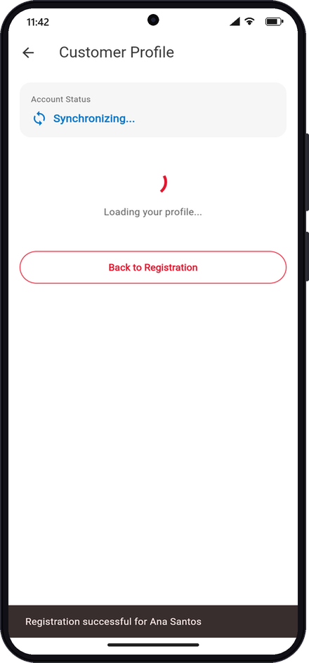
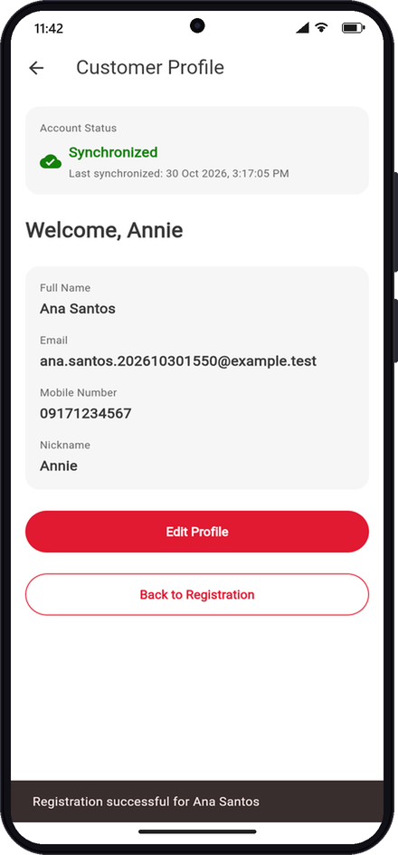
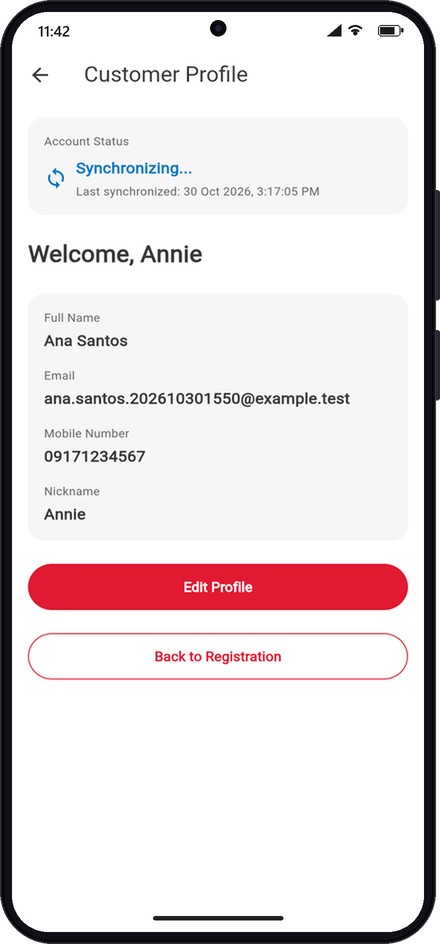
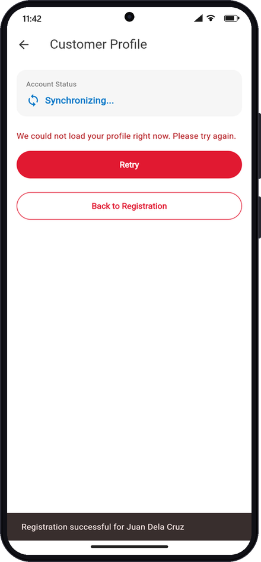
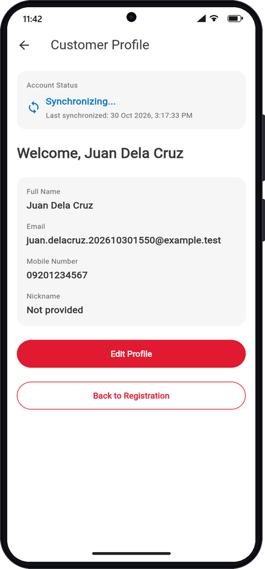
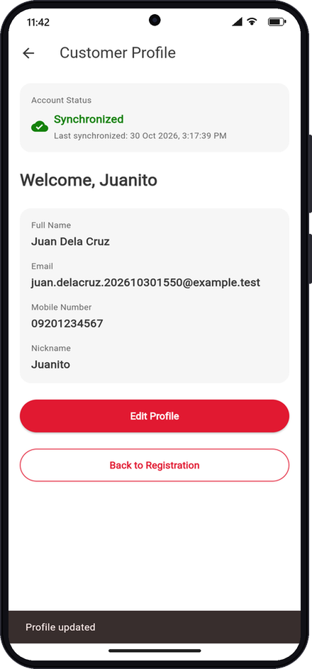

# Week 4 exercise results — screenshots and scenarios

Every screenshot below was captured on **2026-10-30** against the **live**
local stack — Flutter web UI `http://127.0.0.1:5100` (branch
`feature/week-4-dashboard-bloc`, debug build), Spring Boot
`http://localhost:8080`, PostgreSQL `localhost:5432` — by a scripted browser
at a Pixel-class viewport (412×892 CSS px, 2×) and composed into an Android
frame. Test data uses the stamp `202610301550`.

Story guides: [US-07](week-4/account-status-stream.md) ·
[US-08](week-4/external-package.md) · [US-09](week-4/development-workflow.md)
· [US-10](week-4/customer-dashboard-bloc.md).
Full automated matrix: [Test evidence and scenarios](testing.md).

## Scenario summary

| # | Story | Scenario | Result |
|---|---|---|---|
| 1 | US-07/10 | Dashboard opens: profile **loading** while the status stream already shows *Synchronizing...* | Pass — `POST` 201, `id=24` |
| 2 | US-07/08/10 | Profile loaded; status **Synchronized** with intl-formatted *Last synchronized* | Pass |
| 3 | US-07 | Status changes again to *Synchronizing...* with no user action; last sync time kept | Pass |
| 4 | US-10 | Simulated load failure → error + **Retry** (status keeps streaming) | Pass — `POST` 201, `id=25` |
| 5 | US-10 | Retry → profile loaded | Pass |
| 6 | US-10 | Edit Profile → set nickname → Save → dashboard shows `Welcome, Juanito` | Pass — `PUT /api/customers/25` 200 |

## 1. Loading + streaming in parallel

Registered `Ana Santos` / `ana.santos.202610301550@example.test` /
`09171234567` / `Annie`. The dashboard created both blocs: the profile bloc
is in `Loading`, while the status bloc has already received the first
stream value.



## 2. Loaded, synchronized, formatted time

`CustomerProfileLoaded` rendered the null-safe greeting (`nickname` present
→ `Welcome, Annie`). The status stream emitted *Synchronized*; the caption
uses `DateFormat('d MMM y, h:mm:ss a')` → `30 Oct 2026, 3:17:05 PM`.



## 3. Status updates by itself

Three seconds later the stream emitted *Synchronizing...*; the UI rebuilt
automatically (no refresh control exists) and kept the last completed sync
time.



## 4. Load failure with Retry

Back on Registration, turned on **Simulate profile load failure** and
registered `Juan Dela Cruz` / `juan.delacruz.202610301550@example.test`
(no nickname). The profile bloc emitted `LoadFailure`; the status card is
independent and kept streaming.



## 5. Retry succeeds

`CustomerProfileRetryRequested` → `Loading` → `Loaded`.



## 6. Navigation to Edit and back

Edit Profile → nickname `Juanito` → Save. Edit popped with the saved
customer; the dashboard added `CustomerProfileUpdated`, so the greeting
switched from the full name to the nickname.



## Backend confirmation

```text
 id |   full_name    |                  email                  | mobile_number | nickname
----+----------------+-----------------------------------------+---------------+----------
 24 | Ana Santos     | ana.santos.202610301550@example.test    | 09171234567   | Annie
 25 | Juan Dela Cruz | juan.delacruz.202610301550@example.test | 09201234567   | Juanito
```

Browser network log: `POST /api/customers → 201` (twice),
`PUT /api/customers/25 → 200`. Synthetic customers `id=23..25` from this run
and its earlier attempt remain in the local development database.
