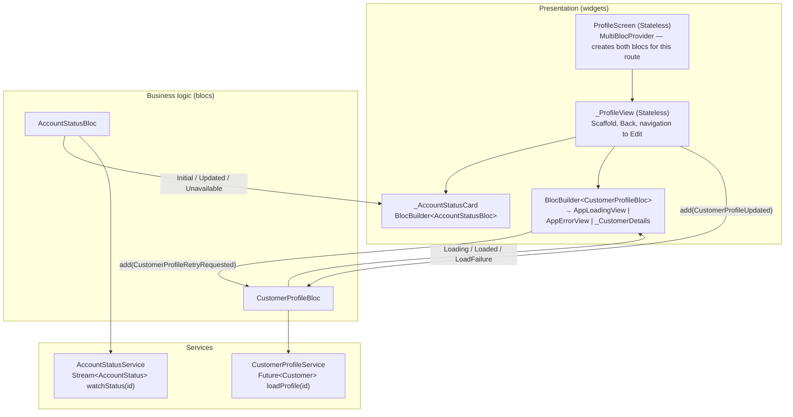

# Final customer dashboard with BLoC (US-10)

> **Business story:** As a customer, I want to see my profile and current
> account status when I open the application so that I can quickly verify
> that my account is active.

## Architecture



## Events and states

**`CustomerProfileBloc`** (`lib/blocs/customer_profile/`)

| Event (UI → bloc) | Handling | States emitted |
|---|---|---|
| `CustomerProfileRequested` (added on create) | `await loadProfile(id)` in `try`/`catch` | `Loaded(customer)` or `LoadFailure(message)` (initial state is `Loading`) |
| `CustomerProfileRetryRequested` (Retry tap) | Ignored unless the current state is a failure; otherwise same load | `Loading` → `Loaded` / `LoadFailure` |
| `CustomerProfileUpdated(customer)` (Edit saved) | No network call — Edit already persisted it | `Loaded(customer)` |

**`AccountStatusBloc`** (`lib/blocs/account_status/`)

| Event | Handling | States emitted |
|---|---|---|
| `AccountStatusSubscriptionRequested` (added on create) | `emit.forEach(watchStatus(id))` | `Updated(status, lastSynchronizedAt)` per value; `Unavailable` on error |

States are `sealed` classes, so the view's `switch` must handle every case —
the compiler rejects a missing state. Each state implements `==`, so
`blocTest` can compare states and Bloc can skip duplicate emissions.

## BLoC responsibilities vs UI responsibilities

| BLoC (business logic) | Widgets (presentation) |
|---|---|
| Calls services, awaits Futures, listens to Streams | Turn taps into **events** (`bloc.add(...)`) |
| Decides the next **state** (loading/success/failure, last sync time, ignoring a duplicate Retry) | Map each **state** to widgets (`BlocBuilder` + `switch`) |
| Maps exceptions to user-facing messages | Navigation, SnackBars, layout, theme tokens |
| No `BuildContext`, no Flutter widgets → unit-tested with `blocTest` | No `try`/`catch`, no service calls |

Compared with Week 3, the `_isLoading`/`_errorMessage`/`_customer` fields
and the `try`/`catch` moved out of `ProfileScreen` into
`CustomerProfileBloc`; the screen became a `StatelessWidget`.

## Acceptance criteria → evidence

| Acceptance criterion | Where | Proof |
|---|---|---|
| Customer data loaded asynchronously | `CustomerProfileBloc._onLoad` awaits `loadProfile` | `customer_profile_bloc_test.dart` *Requested loads the customer by id*; screenshot 01 |
| Loading, success, and error states handled | Sealed `CustomerProfileState` + `switch` | Bloc tests (success, service failure, unexpected error); screenshots 01, 02, 04 |
| Retry works after failure | `CustomerProfileRetryRequested` | Bloc test *Retry after a failure goes loading → loaded*; widget tests from Week 3 still pass; screenshot 05 |
| Nullable customer information handled safely | `Welcome, ${nickname ?? fullName}`; Nickname row `?? 'Not provided'` | Widget test *null-safe greeting*; screenshots 02, 06 |
| Account status updates from a Stream | `AccountStatusBloc` + `emit.forEach` | [US-07](./account-status-stream.md); screenshots 02→03 |
| Navigation works correctly | Registration → Dashboard → Edit → back with the saved customer; Back to Registration | Week 2 edit tests run through the dashboard; screenshot 06 (`PUT` 200) |
| Widget types selected appropriately | See "Widget choices" | — |
| Widget tree and `BuildContext` explained | See below | — |
| Future vs Stream explained | [US-07](./account-status-stream.md#future-vs-stream) | — |
| Package dependency explained | [US-08](./external-package.md) | — |
| BLoC separates UI from business logic | Table above | Blocs tested without widgets |
| Events, states, responsibilities explained | Tables above | — |
| Production improvements described | See below | — |

## Widget choices

| Widget | Type | Why |
|---|---|---|
| `ProfileScreen` | `StatelessWidget` | Holds only constructor input (id, services); `MultiBlocProvider` owns bloc lifetimes, so no `State` is needed. Creating the blocs here scopes them to this route: popping it closes both blocs and cancels the stream. |
| `_ProfileView`, `_CustomerDetails`, `_AccountStatusCard` | `StatelessWidget` | Render whatever state they are given; all mutable state lives in the blocs. Splitting them keeps each `BlocBuilder` rebuild small (a status tick rebuilds only the status card). |
| `RegistrationScreen`, `EditProfileScreen` | `StatefulWidget` (unchanged) | Form drafts with `TextEditingController`s and submit flags are short-lived, screen-local UI state; moving them into a bloc would add ceremony without shared or testable business logic. |
| `AppStatusRow`, `AppLoadingView`, `AppErrorView` | `StatelessWidget` | Reusable presentation in `lib/widgets/`, theme tokens only. |

## Widget tree and `BuildContext`

```text
MaterialApp
└─ Navigator
   ├─ RegistrationScreen
   └─ ProfileScreen                       ← pushed route
      └─ MultiBlocProvider                ← blocs live here
         └─ _ProfileView                  ← its context can "see" the blocs
            └─ Scaffold → … → Column
               ├─ _AccountStatusCard → BlocBuilder<AccountStatusBloc>
               ├─ BlocBuilder<CustomerProfileBloc> → _CustomerDetails …
               └─ AppSecondaryButton (Back)
```

A `BuildContext` is a widget's **position in the tree**. Lookups such as
`context.read<CustomerProfileBloc>()`, `Navigator.of(context)`, and
`ScaffoldMessenger.of(context)` walk **up** from that position. That is why
the blocs are provided by `ProfileScreen` and read from `_ProfileView` — a
child — and why `_openEditProfile` reads the bloc and the messenger **before**
`await Navigator.push(...)`: after the `await` the route may have been popped
and the context unmounted, so it uses the saved references and checks
`bloc.isClosed` instead of touching `context` again.

## What would change for production

* **Real data sources**: implement `CustomerProfileService` with the existing
  `GET` (already available behind `USE_BACKEND_PROFILE`) and the status feed
  with server push (WebSocket/SSE) or polling with backoff; add auth tokens.
* **Dependency injection**: register services and blocs in a container
  (e.g. `get_it`) instead of the hand-wired composition root.
* **Typed failures**: return `Either<Failure, Customer>` (or sealed result
  types) instead of exceptions, with error codes mapped to localized text.
* **State modelling**: `freezed`/`equatable` for states once there are more
  of them; `bloc_concurrency` transformers (e.g. `restartable` for reloads).
* **Persistence/offline**: cache the last profile and sync time; show stale
  data with a banner while re-syncing.
* **Navigation**: declarative routing (`go_router`) with typed routes and
  deep links; a real "home" dashboard after login rather than after
  registration.
* **Observability and quality**: `BlocObserver` logging, crash reporting,
  analytics; golden tests and integration tests on devices; localization of
  all strings and the date format via `intl` locales.

## Related

* [Display account status (US-07)](./account-status-stream.md)
* [Add an external package (US-08)](./external-package.md)
* [Practice development workflow (US-09)](./development-workflow.md)
* [Week 4 exercise results](../week-4-exercise-results.md)

# Citations

[1][Profile/dashboard screen](../../lib/screens/profile_screen.dart)
[2][Customer profile bloc](../../lib/blocs/customer_profile/customer_profile_bloc.dart)
[3][Account status bloc](../../lib/blocs/account_status/account_status_bloc.dart)
[4][Bloc tests](../../test/blocs/customer_profile_bloc_test.dart)
